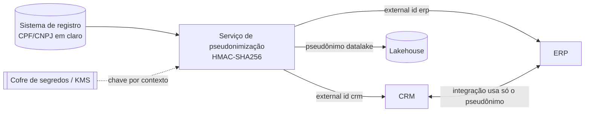

<h1 align="center">🔐 lgpd-pseudonymization-reference</h1>

<p align="center">
  <strong>Referência de arquitetura para pseudonimizar CPF/CNPJ em integrações entre plataformas (CRM, ERP, ITSM e dados), alinhada à LGPD.</strong>
</p>

<p align="center">
  
  
  
  
</p>

---

## 🎯 O problema

CPF e CNPJ costumam virar a "chave universal" entre sistemas: estão no CRM, no ERP, no service desk e no data lake. Isso espalha um identificador forte por todo o ecossistema, amplia a superfície de vazamento e dificulta cumprir a LGPD (minimização, finalidade e segurança).

## 💡 A solução

Cada plataforma recebe um **identificador pseudônimo estável**, derivado com **HMAC-SHA256** e uma **chave secreta** guardada no cofre de segredos. O documento original fica só no sistema de registro que precisa dele.

- **Determinístico** — o mesmo documento gera o mesmo pseudônimo, então joins e deduplicação continuam funcionando.
- **Irreversível sem a chave** — ao contrário de um hash simples, não dá para recalcular por força bruta os ~10⁹ CPFs possíveis.
- **Separado por contexto** — `crm` e `datalake` recebem pseudônimos diferentes, evitando correlação indevida.
- **Formato UUID** — pronto para campos *External ID* (Salesforce, SAP e afins).

## 🗺️ Arquitetura



Mais detalhes, decisões e riscos em [`docs/arquitetura.md`](docs/arquitetura.md).

## 🚀 Como usar

```bash
git clone https://github.com/ncontatori/lgpd-pseudonymization-reference.git
cd lgpd-pseudonymization-reference
python3 src/pseudonymize.py          # demonstração com CPF fictício
pip install pytest && pytest -q      # testes
```

```python
from pseudonymize import pseudonymize, external_id

# em produção, a chave vem de PSEUDONYM_KEY (injetada pelo cofre de segredos)
pseudonymize("529.982.247-25", context="datalake")   # -> 'a677…59e5'
external_id("11.222.333/0001-81", context="crm")      # -> UUID para External ID
```

## 🧱 Estrutura

| Caminho | Conteúdo |
|---|---|
| `src/pseudonymize.py` | Validação de CPF/CNPJ, pseudônimo HMAC e External ID em UUID |
| `tests/` | Testes de determinismo, separação por contexto e chave |
| `docs/arquitetura.md` | Decisões, rotação de chave, riscos e checklist LGPD |

## ⚠️ Aviso

Material educacional e de referência, com dados fictícios. **Não é aconselhamento jurídico.** Valide o desenho com o DPO e o jurídico da sua organização.

---

<p align="center"><sub>Feito por <a href="https://ncontatori.github.io">Nestor Cremm Contatori</a> · <a href="https://linkedin.com/in/nestorcontatori">LinkedIn</a></sub></p>
