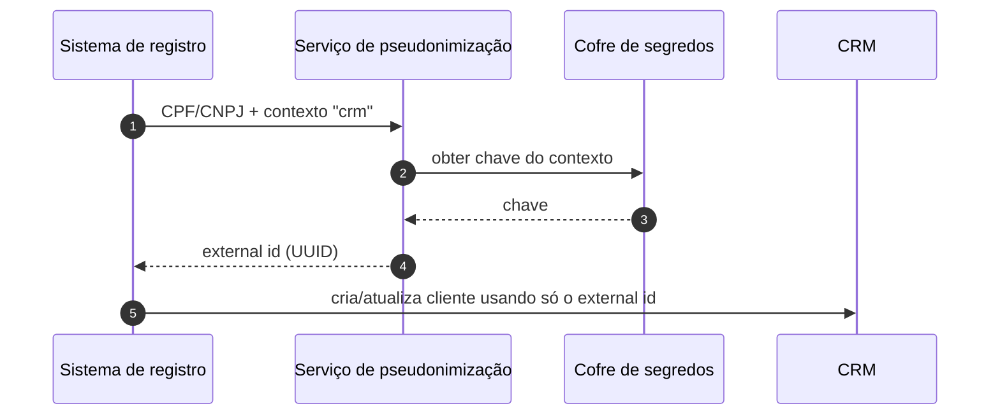

# Arquitetura de referência — pseudonimização de identificadores

## Contexto

Em ecossistemas com CRM, ERP, ITSM e plataforma de dados, o CPF/CNPJ tende a ser usado como chave de integração. Este documento propõe tratá-lo como **dado restrito**, presente apenas no sistema de registro, e usar **pseudônimos** em todo o resto.

## Decisões

| # | Decisão | Motivo |
|---|---|---|
| 1 | HMAC-SHA256 com chave secreta, não hash simples | O espaço de CPFs é pequeno (~10⁹); um SHA-256 puro é revertido por força bruta em minutos |
| 2 | Uma chave por **contexto** (ou o contexto no conteúdo do HMAC) | Impede correlacionar o mesmo titular entre domínios sem autorização |
| 3 | Chave no cofre de segredos/KMS, injetada em tempo de execução | Chave fora do código e dos repositórios; acesso auditável |
| 4 | Normalizar e validar o documento antes de pseudonimizar | Evita pseudônimos diferentes para o mesmo documento com pontuação diferente |
| 5 | Expor também em formato UUID | Compatível com campos de External ID das plataformas |

## Fluxo

## Rotação de chave

1. Gerar nova chave (`v2`) no cofre, mantendo `v1` ativa.
2. Recalcular os pseudônimos em lote e gravar em coluna nova (`external_id_v2`).
3. Migrar integrações para `v2`; desativar `v1` ao fim da janela.

Guarde a **versão da chave** junto do pseudônimo para permitir a convivência.

## Riscos e mitigação

- **Vazamento da chave** → rotação imediata; acesso mínimo; monitoramento do cofre.
- **Reidentificação por atributos** (nome, e-mail, data de nascimento) → pseudonimizar o identificador não basta; aplicar minimização e controle de acesso nos demais campos.
- **Pseudônimo ≠ anonimização** → para a LGPD, dado pseudonimizado continua sendo dado pessoal.

## Checklist LGPD

- [ ] Finalidade de cada contexto documentada
- [ ] Base legal identificada por tratamento
- [ ] Chaves no cofre, com acesso auditado
- [ ] Documento em claro só no sistema de registro
- [ ] Processo de rotação testado
- [ ] Registro das operações de tratamento atualizado
